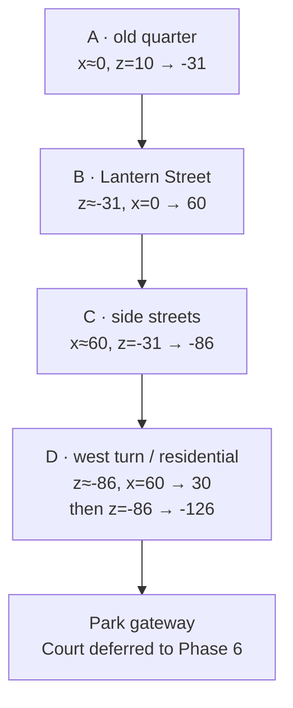

# Phase 3 — Connected nighttime city

Status: implemented locally on `experiment/connected-night-city`; not deployed or merged into production.
Date: 2026-10-25

## 1. Expanded city

`/city-preview` extends the Phase 2 winter street into one continuous historic city. A warm bookshop arrival gives way to restaurants, an arcade and a music venue; the route turns past a boxing gym, a modest alley hoop and an independent print shop, then settles into a residential lane and park gateway. Seventeen ambient pedestrians, recessed furnished windows, swaying signs, motivated lighting and corridor-constrained snow connect the districts.

The production homepage, observatory, camera study, project/experience data, public contact, infrastructure plan and embedded resume remain intact. This phase adds no full portfolio panels and no final basketball court. Samana informs the ambition for continuous camera direction and physical detail; none of its source, models, images or branding is included, and its precise proprietary implementation is not claimed.

## 2. Four-district spatial layout

World units are metres. Every district is built into the same scene with identity chunk transforms; stationary geometry is not transported around the camera.

| District | Main route | Character and details |
| --- | --- | --- |
| A — The old quarter | `(0,10)` north toward `(0,-31)` | Historic commercial frontage, Late Edition bookshop, Nightjar café, balconies/awnings, inset rooms, benches/planters and five pedestrians |
| B — Lantern Street | Turn east along `z=-31`, toward `x=60` | Hotel, cafés/restaurants, arcade with a clear entrance, Blue Note music venue, overhead festoons, seven additional pedestrians |
| C — The side streets | Turn north at `x=60`, toward `z=-86` | Second Round gym with ring/bags and a small Ippo print, repair shop, side alley at `z=-68.5`, hoop/net, Corner Print, four additional pedestrians |
| D — North of the noise | Turn west at `z=-86` toward `x=30`, then north toward `z=-126` | Lower houses, quieter practicals, North Studio, garden walls, leafless park-edge branches, one additional pedestrian and gateway at `z=-131.5` |

End-of-street facades, building returns and background houses give corners a physical destination. Street and sidewalk rectangles, pedestrian lanes, district bounds and landmark records share [layout.ts](../../src/lib/city/layout.ts). The camera path is sampled against that navigation map in tests. The alley is a small side space, not a substitute for the deferred court.

## 3. Camera system

The retained Three.js camera director now combines:

- A 35-control-point centripetal translation rail with a 3,200-division arc-length table.
- Fourteen authored shot-distance pacing anchors; actual distance, not arbitrary section index, governs travel. Maximum catch-up speed steps down from 17 to 15, 13 and 11 m/s through the journey. Those limits apply to large navigation jumps; normal native scrolling and damped arrival are slower.
- Independent monotone yaw/pitch and FOV channels. Orientation is sampled at 49 uniform keys with precomputed SQUAD tangents; horizon leveling prevents unintended roll.
- A critically damped cursor channel, bounded to approximately 6cm lateral/2.5cm vertical translation and small local angular offsets. Touch uses the authored framing without mouse offsets.
- A rendered progress shared by district navigation, shot captions, hover availability, environment thinning and district preloading. Raw scroll intent may run ahead; the UI follows the camera's actual arrival.
- Availability limits at the last finished district. Loading a distant district link does not teleport through a missing world. The cap releases once construction and shader compilation finish. Visited chunks persist for reverse traversal.

A test found that a low-resolution inverse distance lookup could hold progress about 0.0000013 short of a destination; increasing the binary inversion precision resolved this. Forward/backward samples are deterministic, orientation remains level, and travel never depends on React frame updates.

## 4. Shot sequence

`at` identifies each intended composition; the metadata's reveal interval can begin shortly before its arrival. District navigation always derives from actual rendered progress.

| Progress | Composition | Position `(x,y,z)` | Direction / subject |
| ---: | --- | --- | --- |
| 0% | Arrival | `(0.4,2.15,10)` | Wide street establishment, warm bookshop against cool masonry |
| 6.5% | Under the awnings | `(0.3,1.35,-2)` | Low-angle balconies/window detail |
| 12% | Late Edition | `(1.2,1.7,-9.5)` | Side-facing bookshop approach |
| 20% | Passing by | `(-0.2,2.75,-23)` | Elevated intersection reveal; bookshop passes behind |
| 28% | Lantern Street | `(11,2.8,-31.5)` | East turn, hotel and café framing |
| 36% | After the last train | `(27,1.8,-31.1)` | Arcade/restaurant approach |
| 43% | Blue Note | `(41,2.6,-30.6)` | Reverse-side venue composition |
| 52% | A different street | `(60.7,2.8,-40.5)` | North turn and fresh architecture |
| 59% | Late session | `(61.2,1.6,-56)` | Low gym window, ring and Ippo print |
| 67% | Between buildings | `(60.4,1.9,-68.5)` | Side alley/hoop reveal |
| 74% | Corner Print | `(61,1.85,-78)` | Independent shop and hanging sign |
| 83% | North of the noise | `(53,3.2,-86)` | Wider westward residential reveal |
| 93% | Last few windows | `(30,2.2,-109)` | North Studio side composition |
| 100% | Beyond the last light | `(30.4,2.35,-126)` | Calm park-gateway approach; no completed court |

Sources: [camera.ts](../../src/lib/city/camera.ts), [route.ts](../../src/lib/city/route.ts).

## 5. Assets and licenses

The main architecture remains the detailed Poly Haven Modular Urban Apartments Facade GLB, with source cornices, windows, doors, masonry, normal maps and AO. The Phase 2 lantern, bench, table/chair set, books, shelf, planter, paving/brick/concrete maps and HDR are reused. These are **CC0**; creators, direct source pages and preparation steps remain in [city asset provenance](../assets/city-preview.md). No primary building is replaced with a placeholder box skyline. Original shell/roof/awning/interior geometry supplements the detailed facade modules.

The ambient pedestrians use a new **83,936-byte**, 1,604-triangle Meshopt GLB derived from the already retained **CC0 Kenney Animated Characters Protagonists 1.1** source. Independent skeletons share geometry, skin and three clothing materials. [Pedestrian provenance](../assets/city-pedestrian.md) documents the conversion, joint/UV preservation and reproduction command.

The gym's `ippo-print.webp` is an original generated fan illustration requested for this neighborhood, not a downloaded official image or another artist's work. It is recorded separately from CC0 source assets in the provenance document. It is only fetched while C preloads. Businesses, arcade cabinets, gym equipment, alley hoop, garden details and signs are original environmental staging, not claims about the owner's clients or employment.

## 6. NPC and environmental animation

Seventeen pedestrians have distinct start offsets, 0.56–0.80m/s walking speeds, stature and dwell times; some stand in small conversations. Routes occupy specific sidewalk lanes and avoid furniture. A pedestrian enters/leaves the arcade through an actual open 2.73m bay, with no invisible glazing, shutter or plinth across the entrance. Root elevation follows the slightly raised interior floor.

Motion uses bounded 120Hz substeps, eased acceleration/braking and limited physical turns. Distance advances stride phase; the retained analytic two-bone leg rig supplies stance anchors, weight transfer, alternating arms and restrained idle motion. Nearby rigs update at 60Hz, mid-distance at 30Hz, distant at 12Hz; off-camera skeleton evaluation stops. World movement remains continuous. Forward proximity yielding supplements separated authored routes; this is not a full navigation-mesh or crowd-physics simulation.

A five-minute deterministic route simulation checks walkable containment, continuous movement, minimum pair separation and two-way arcade entry. The retained actual-rig test checks planted stance feet. Browser captures review actual pedestrian placement. Small groups, shop interiors and practical illumination imply activity without synchronized crowds.

Snow wraps around the camera on the GPU, is masked to the street/alley corridors and thins in D. Nearby flakes accept a bounded cursor influence. Hanging signs have independent phases and local responsiveness. Only the four reserved storefront fixtures respond to hover/focus; the rest of the city remains scenery. Atmosphere can pause without disabling intentional camera navigation.

## 7. Rendering, lighting and loading

One renderer, one scene and one owned render loop serve the journey. The Phase 2 ACES/sRGB pipeline remains: linear half-float target → scene → high-threshold reduced-resolution bloom → linear-space SMAA → final OutputPass. There is no added SSAO, temporal pass or local reflection render. PMREM provides environment response; source normal/roughness/AO maps, static shadows and contact surfaces provide grounding.

Authored fixtures register into a fixed **nine-light** budget: four points, two areas, one shadowed spot, moon and hemisphere. Nearby sources cross-fade through zero before assignment, avoiding an unbounded light count or a light flying between shops. The moon shadow recenters at district changes/discrete travel distances and remains frozen between those updates. Most geometry does not animate or rerender through React.

District A becomes usable before B/C/D are built. B/C/D prebuild at .12/.36/.67 progress or when directly requested. Construction reuses repeated shape geometry, expands shared quantized attributes once and yields during batching at a roughly 4ms work budget; new textures are preuploaded while chunks remain hidden, chunks compile against the fixed main-scene lights, then release the camera cap. Shared source assets/maps/materials are not redownloaded per district. C's new print is deferred. Loaded districts stay resident for reversal; spatial chunk visibility, per-mesh frustum culling, per-building material batching and instanced books limit rendering work. This is staged runtime composition, not four independently downloaded complete world files.

Mobile defaults to real 3D with native touch scrolling. DPR starts at at most 1.15 versus desktop 1.5, moon/spot shadows are 1024/512 versus 2048/1024, snow is 650 versus 1,700 points, and bloom resolution is lower. Sustained slow frames can reduce DPR to 1. Hidden tabs stop; settled paused views stop rendering. Skeletons, instance resources, shadow/PMREM/composer targets, geometry, textures/ImageBitmaps and listeners are disposed on exit/cancellation/failure.

## 8. Verification and measurements

Verification:

- `npm run lint`, `npm run typecheck` and `npm run build` pass.
- The complete existing suite passed **53/53** before the final residential/loading refinements.
- After those refinements, all **16 affected city tests** passed in 2.1 minutes, including a new native touch-swipe test. These cover route containment/reversal, level quaternion continuity, load caps, display-rate behavior, pedestrian separation/entry over five minutes, desktop/mobile 3D, localized warmth/sign/pause, keyboard composition controls, four successfully loaded fallback images, reduced motion, initial/deferred-asset/WebGL/context failure, no JavaScript and restoring the original portfolio renderer.
- The earlier complete suite also checked the unchanged portfolio records, contact, cloud plan, original camera study, archived rig logic and embedded PDF. The full new 54-test suite was not rerun as one batch after the final city-only changes; the affected subset was rerun instead.
- Actual desktop and 390×844 scene captures were reviewed, including all three district boundaries. The review prompted street-end facades, muted pedestrian clothing, textured alley walls and furnishing the residential studio. The final loading refinements preserve that geometry/material appearance.

Measured production setup: **Apple M4**, ANGLE Metal, installed headless **Chrome 155.0.8059.86**, **1440×900**, device scale/DPR **1**, local Next production server on `127.0.0.1:3014`, no software renderer, CPU slowdown or network throttling. Local development iterations can warm OS/driver caches; these are not cold-device, remote-network or physical-phone measurements. No other 3D browser suite ran concurrently. Reproduce with `node scripts/profile-city.mjs http://127.0.0.1:3014` against an explicitly started production server. [Raw JSON](phase-3/performance.json).

| Measurement | Result |
| --- | --- |
| Navigation to scene-ready | **1,360 ms**, including HTML/hydration/import and initialization |
| Instrumented asset load / scene preparation / shader compile | **148.9 / 517.4 / 59.7 ms**; excludes earlier HTML/hydration/import time |
| Runtime asset requests across all sampled districts | **23**, **10,315,746 encoded bytes**, **10,322,646 transferred bytes**; excludes application JS, CSS, fonts and fallback images |
| Fresh-scene forward jump, including staged construction and camera availability limits | **26.05 s**, **59.3 mean fps**, **16.8 ms p95**, **116.6 ms worst**, **3 frames over 50 ms** |
| Reverse travel with visited chunks resident | **17.39 s**, **58.6 mean fps**, **16.8 ms p95**, **100.0 ms worst**, **2 frames over 50 ms** |
| Final GPU resources reported | **137 textures**, **734 geometries**, 17 pedestrians; fixed nine-light budget |
| Runtime page errors | **0** |

The forward/reverse timing run reloads a fresh scene after the individual views, so source HTTP responses are cached while district geometry must be constructed again. Its separate reload transfer figure in the JSON must not be interpreted as the cold network download size. The longer forward duration includes waiting at safe availability limits during an aggressive jump across the entire city; normal per-district exploration gives preloading more lead time.

| Composition | Mean fps | p95 frame | Reported calls | Reported triangles |
| --- | ---: | ---: | ---: | ---: |
| arrival | 60 | 16.7 ms | 240 | 1604696 |
| bookshop | 60 | 16.8 ms | 79 | 589057 |
| corner | 60 | 16.8 ms | 281 | 1589140 |
| arcade | 60 | 16.7 ms | 176 | 1120732 |
| music | 59 | 16.7 ms | 119 | 834175 |
| north-turn | 60 | 16.7 ms | 170 | 1002611 |
| gym | 60 | 16.8 ms | 77 | 406325 |
| alley | 59.3 | 16.8 ms | 63 | 293869 |
| printshop | 60 | 16.7 ms | 53 | 240633 |
| quiet-turn | 60 | 16.8 ms | 236 | 1411215 |
| residential | 60 | 16.8 ms | 96 | 449413 |
| last-light | 60 | 16.7 ms | 63 | 258137 |

These 180-frame per-view samples include any upcoming district work still in progress, rather than artificially waiting for every distant district. `cpuRenderMs` in the raw record measures CPU submission, not GPU execution. Calls/triangles include the active rendering pipeline and may include a shadow refresh.

**Remaining performance limit:** loading/first-use/GC hitches have been reduced but not eliminated. A 4ms batching work budget, shared shape caches, once-expanded source attributes, spaced background uploads and reuse of Three's global area-light lookup textures improve pacing without removing geometry. Each individual merge/upload can still exceed the budget. Future work should investigate offline district baking and narrower GPU upload scheduling before claiming consistently hitch-free traversal, especially on physical lower-powered devices.

## 9. Representative screenshots

All images below are actual Chrome captures of the implemented production build. Full camera/UI views and three district transitions are included. Fallback images are captures of the same scene with UI hidden, not reference imagery.

| View | Capture |
| --- | --- |
| A arrival | [Arrival](phase-3/arrival.webp) |
| A bookshop | [Late Edition](phase-3/bookshop.webp) |
| A → B | [First turn](phase-3/first-turn.webp) |
| B music venue | [Nightlife](phase-3/nightlife.webp) |
| B → C | [North turn](phase-3/north-turn.webp) |
| C gym | [Gym](phase-3/gym.webp) |
| C alley | [Alley hoop](phase-3/alley.webp) |
| C independent shop | [Corner Print](phase-3/printshop.webp) |
| C → D | [Quiet turn](phase-3/quiet-turn.webp) |
| D studio | [Residential](phase-3/residential.webp) |
| D park approach | [Gateway](phase-3/gateway.webp) |
| Narrow live 3D | [Mobile arrival](phase-3/mobile-arrival.webp), [mobile gym](phase-3/mobile-gym.webp) |

## 10. Known limits and Phase 4

- This is an authored linear camera journey, not a free-roaming city. The bounds and furnished views are designed around that journey. It does not claim a complete open-world simulation.
- Architecture retains detailed source geometry and varied massing/floors/interiors, but still uses one coordinated facade kit. Additional bespoke corner assets would further reduce family resemblance. The alley/gym/park details are original supporting geometry.
- NPCs use a stylized shared Kenney body rather than bespoke realistic humans or motion-capture clips. Procedural leg planting improves grounding; identical base silhouettes and finite route logic remain visible limits. Proximity yielding is not global crowd pathfinding.
- Shadow maps intentionally refresh discretely. Dynamic pedestrians use contact surfaces rather than individual live shadow maps. Reflections are environment-based; local storefronts are not mirrored accurately on the road. No claim of fully baked global illumination is made.
- Staged chunk construction reduces opening work, but shared building/furniture assets still download initially. Geometry batching and shader compilation can cause isolated main-thread frames; the travel measurements below expose those rather than reporting only settled FPS.
- Mobile browser emulation verifies functionality/composition and quality settings. Physical Windows, Android and iOS devices still need manual profiling; headless Apple GPU results do not predict those devices.
- Stable `late-edition`, `blue-note`, `corner-print`, `north-studio` records reserve projects, experience, about and skills. Phase 4 should add direct accessible record navigation and authored object-specific focus/readers while preserving factual portfolio content. Most buildings should remain noninteractive.
- The residential park gateway only prepares Phase 6. No final court geometry or finale sequence is built here.

No production deploy, push or merge is part of this phase.
